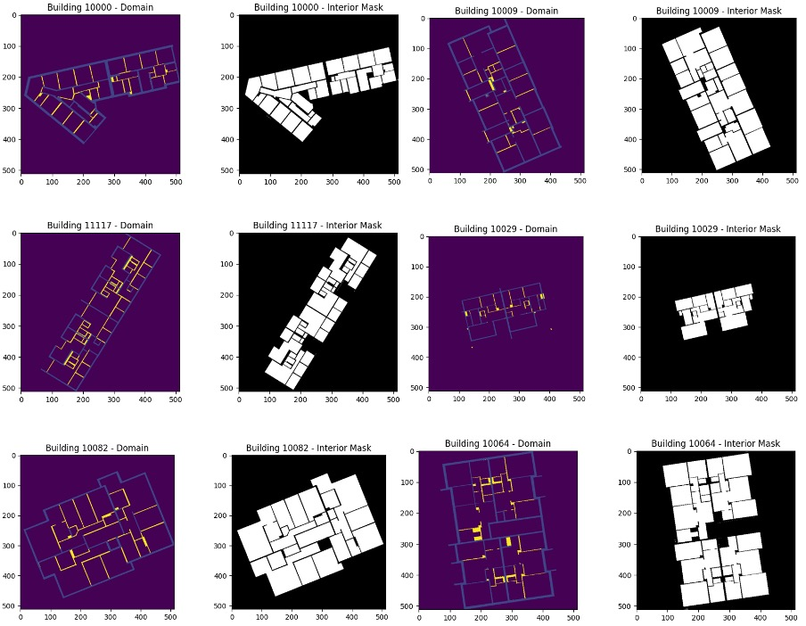
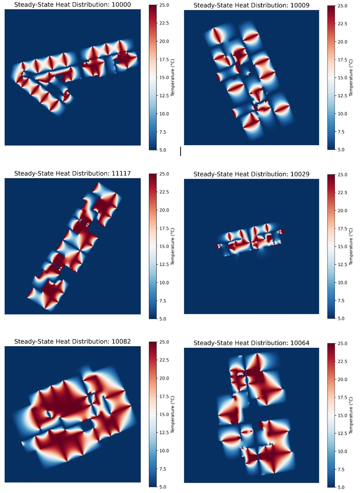

# Thermal PDE Acceleration Pipeline for Floorplan Heat Diffusion

> This project was developed for **DTU 02613: Python and High-Performance Computing (Spring 2025)** at the Technical University of Denmark. The original baseline problem, dataset (Modified Swiss Dwellings), and reference implementation are credited to the course creators.

Numerical Laplace PDE solver & performance engineering across 4,500+ architectural floorplans via CPU Dynamic Parallelism, Numba JIT, Custom CUDA, and Fused CuPy Acceleration.

[](https://kurser.dtu.dk/course/02613)


[](https://numba.pydata.org/)

---

## Table of Contents
- [Project Background & Problem Formulation](#project-background--problem-formulation)
- [Key Achievements & Technical Highlights](#key-achievements--technical-highlights)
- [Performance Benchmark & Scaling Roadmap](#performance-benchmark--scaling-roadmap)
- [Technical Deep-Dives & Profiling Discoveries](#technical-deep-dives--profiling-discoveries)
- [Physical Insights & Domain Results](#physical-insights--domain-results)
- [How I Used GenAI (Gemini) as a Technical Multiplier](#how-i-used-genai-gemini-as-a-technical-multiplier)
- [Repository Structure & Directory Layout](#repository-structure--directory-layout)

---

## Project Background & Problem Formulation

### 1. The Real-World Domain Problem
This project evaluates an experimental building heating solution—**Wall Heating**—across **4,571 building floorplans** from the *Modified Swiss Dwellings* dataset. Heating elements are embedded into non-structural interior walls to act as continuous thermal radiators, while structural load-bearing walls remain cold.

The goal is to simulate steady-state room heat distribution and evaluate human thermal comfort ($\ge 18^\circ\text{C}$) and cold-spot risks ($< 15^\circ\text{C}$).

* **Full Dataset Path (DTU HPC Cluster)**: `/dtu/projects/02613_2025/data/modified_swiss_dwellings/`
* **Local Sample Data**: Lightweight test floorplans are provided under `data/sample_floorplans/` for standalone reproduction.

### 2. Mathematical Modeling (2D Thermal PDE)
Let $u(x,y)$ denote the steady-state temperature at coordinate $(x,y)$. The overall heat distribution across a floorplan is modeled by solving 2D **Laplace's Equation**:

$$\frac{\partial^{2}u}{\partial x^{2}} + \frac{\partial^{2}u}{\partial y^{2}} = 0$$

Subject to strict **Dirichlet Boundary Conditions**:
* **Interior Heated Walls**: $u(x,y) = 25^\circ\text{C}$ (fixed)
* **Load-bearing Walls**: $u(x,y) = 5^\circ\text{C}$ (fixed)
* **Interior Rooms**: Unconstrained, solved via stencil relaxation.

### 3. Numerical Discretization (Jacobi Iterative Solver)
Discretized on a $514 \times 514$ grid, the temperature $u_{i,j}$ at each interior grid point is iteratively updated as the average of its 4 orthogonal neighbors:

$$u_{i,j}^{(k+1)} = \frac{1}{4} \left( u_{i,j-1}^{(k)} + u_{i,j+1}^{(k)} + u_{i-1,j}^{(k)} + u_{i+1,j}^{(k)} \right)$$

Updates repeat until maximum iteration or convergence ($\Delta = \max\vert{}u^{(k+1)} - u^{(k)}\vert{} < \text{atol}$).

---

## Key Achievements & Technical Highlights

* **24.3x Peak Speedup**: Scaled processing speed **from ~13.9 hours down to ~34 minutes** for all 4,571 floorplans.
* **Profiling-Driven Memory Optimization**: Discovered via NVIDIA Nsys that **88.7% of CUDA API time** was spent on dynamic allocation (`cudaMalloc`). Optimized convergence evaluation checks, reducing kernel launch calls by **98.4%**.
* **Chunked HPC Execution Strategy**: Split the full dataset (4,571 floorplans) into two independent batch scripts (`sub_final_2000.sh` & `sub_final_part2.sh`) to avoid cluster wall-clock time limits, then merged the output results using `task12_summary.py`.
* **AI-Assisted Development**: Used Gemini as a coding assistant to help analyze profiling logs, optimize memory loops, and fix CUDA boundary errors.
* **Physical Evaluation**: Simulated 4,500+ buildings, showing that wall heating alone is ineffective—only **17.6%** of floorplans meet human thermal comfort ($\ge 18^\circ\text{C}$) over more than half of their room area.

---

## Performance Benchmark & Scaling Roadmap

Extrapolated from a benchmark subset of 20 floorplans ($514 \times 514$ grids) to the full dataset (4,571 floorplans):

| Optimization Stage | Tech Stack & Optimization Strategy | Time (20 Plans) | Speedup Factor | Full Dataset Est. (4,571 Plans) |
| :--- | :--- | :---: | :---: | :---: |
| **Task 2: Baseline** | Pure NumPy Slicing (Single Core) | 219.0 s | 1.0x | ~13.9 hours |
| **Task 5: Multi-Core CPU** | Static Scheduling (`multiprocessing`, 16 cores) | 125.6 s | 1.7x | ~3.19 hours |
| **Task 6: Multi-Core CPU** | Dynamic Scheduling (`chunksize=1`, 16 cores) | 84.6 s | 2.6x | ~2.15 hours |
| **Task 7: CPU Acceleration** | Numba `@njit` (Cache-friendly C-contiguous loops) | 63.0 s | 3.5x | ~4.00 hours |
| **Task 8: Custom GPU Kernel** | Numba `@cuda.jit` + Pre-allocated Static Arrays | 27.0 s | 8.1x | ~1.70 hours |
| **Task 9: Naive GPU** | High-level CuPy Array Operations | 55.0 s | 4.0x | ~3.49 hours |
| **🎯 Task 10: Fused GPU** | **CuPy `@cp.fuse()` + Pipelined Convergence (1/10 iter)** | **9.0 s** | **24.3x** | **~34 minutes** |

---

## Technical Deep-Dives & Profiling Discoveries

### 1. Dynamic Task Dispatch for Variable Geometries
* **Problem**: Different floorplans require vastly different iteration counts to reach numerical convergence. Static batch allocation caused CPU core idling.
* **Solution**: Implemented dynamic worker pools (`multiprocessing.Pool(chunksize=1)`). Workers process the next available plan immediately upon completion, dropping execution time by **32.7%** compared to static scheduling at 16 cores.

### 2. Cache-Friendly JIT Compilation (`@njit`)
* **Strategy**: Replaced high-level NumPy array slicing with explicit nested loops structured in **row-major order** (outer loop `i` over rows, inner loop `j` over columns).
* **Impact**: Matches C-contiguous memory layout, minimizing CPU L1/L2 cache misses and delivering a **3.48x speedup** over the CPU baseline.

### 3. Profiling-Driven Kernel Fusion & Stream Pipelining
* **Nsys Profiling Discovery**: High-level CuPy code suffered from **2,177 `cuLaunchKernel` calls** and spent 88.7% of CUDA API time in dynamic allocation (`cudaMalloc`) due to checking convergence (`delta < atol`) every iteration.
* **Refactoring**:
  1. Consolidated 4-point stencil averaging and mask operations into a single unified GPU kernel via `@cp.fuse()`.
  2. Modified the host loop to evaluate convergence **only once every 10 iterations**, dropping launch calls from 2,177 to 35 (**98.4% reduction**).

---

## Physical Insights & Domain Results

#### 1. Task 1: Initial Domain & Mask Layout

*Initial boundary condition domain (heated/cold walls) and interior room masks across sample floorplans.*

#### 2. Task 3: Steady-State Thermal Equilibrium Solutions

*Steady-state room heat distribution solved via Jacobi iterative method.*

* **Temperature Distribution**: Across all 4,571 floorplans, the equilibrium mean temperature exhibits a unimodal, bell-shaped distribution centered around **$14.69^\circ\text{C}$** ($\sigma \approx 6.80^\circ\text{C}$).
* **Thermal Comfort ($\ge 18^\circ\text{C}$)**: Only **17.6% (804 buildings)** satisfy the comfort threshold over $>50\%$ of their floor area.
* **Cold Deficit ($< 15^\circ\text{C}$)**: **54.1% (2,471 buildings)** remain below $15^\circ\text{C}$ over most of their layout, proving wall heating alone is structurally insufficient without supplementary insulation.

---

## How I Used GenAI (Gemini) as a Technical Multiplier

Coming from a mathematics/statistics background, I strategically leveraged **Gemini (GenAI)** as an engineering pair-programmer:
1. **Profiling Log Analysis**: Converted raw `nsys` profiler outputs into explicit refactoring targets, uncovering asynchronous queue locks and dynamic allocations (`cudaMalloc`).
2. **CUDA Boundary Handling**: Restructured 2D thread index bounds (`cuda.grid(2)`) to eliminate memory segmentation faults during GPU stencil calls.
3. **Pipelining**: Designed async CPU-GPU execution pipelines to eliminate redundant PCIe data transfers.

---

## Repository Structure & Directory Layout

```text
thermal-hpc-acceleration/
├── README.md                      # Project documentation and performance report
├── requirements.txt               # Dependency specs (NumPy, Numba, CuPy, etc.)
│
├── data/                          # Floorplan input datasets
│   └── sample_floorplans/         # Sample domain (*_domain.npy) & mask (*_interior.npy)
│
├── docs/                          # Visual artifacts and heatmaps
│   └── images/
│       ├── task1_raw_input.png    # Task 1: Input data visualization
│       └── task3_heatmaps.png     # Task 3: Simulation heatmaps
│
├── src/                           # Core Source Code Directory
│   ├── baseline/
│   │   └── simulate.py            # Task 2: Single-core NumPy reference implementation
│   │
│   ├── cpu_optimization/
│   │   ├── simulate_kernprof.py   # Task 4: Line-by-line profiling via line_profiler (@profile)
│   │   ├── simu_para_static.py    # Task 5: Static chunking multi-processing implementation
│   │   ├── simu_para_dynamic.py   # Task 6: Dynamic load balancing queue multi-processing
│   │   └── simu_numba.py          # Task 7: CPU JIT compilation via Numba (@njit)
│   │
│   ├── gpu_acceleration/
│   │   ├── simu_gpu.py            # Task 8: Custom Numba CUDA Kernel execution (@cuda.jit)
│   │   ├── simu_cupy.py           # Task 9: Baseline CuPy array acceleration on GPU
│   │   ├── simu_cupy_fused_mask.py# Task 10: Fused CuPy Kernel for interior mask updates (@cp.fuse)
│   │   ├── simu_final.py          # Task 12: Full batch GPU execution (Part 1/2)
│   │   └── simu_final_part2.py    # Task 12: Full batch GPU execution (Part 2/2)
│   │
│   └── visualization/
│       ├── t1-vis.py              # Task 1: Raw Data Reading and Initial Domain Visualization
│       ├── simulation_vis.py      # Task 3: Simulation result heatmap plotting
│       └── task12_summary.py      # Task 12: Result aggregation & statistics solver
│
├── profiling/                     # Performance Engineering & Profiling Artifacts
│   ├── kernprof_analysis/         # CPU line-by-line profiling logs
│   └── nsys_reports/              # NVIDIA Nsys GPU trace logs & CUDA API bottleneck data
│
└── hpc_scripts/                   # LSF 10 Cluster Batch Submission Scripts (DTU DCC)
    ├── submit_task1.sh            # Task 1: Data extraction and cluster visualization script
    ├── submit_task2.sh            # Task 2: LSF batch submission script for baseline benchmark
    ├── profile_task4.sh           # Task 4: LSF job batch script for kernprof analysis
    ├── static_batch.sh            # Task 5: Multi-core scaling benchmark (Static scheduling)
    ├── dynamic_batch.sh           # Task 6: Multi-core scaling benchmark (Dynamic scheduling)
    ├── sub_njit.sh                # Task 7: LSF submission for Numba CPU JIT evaluation
    ├── sub_gpuv.sh                # Task 8: LSF job submission script for NVIDIA GPU node
    ├── sub_cupy.sh                # Task 9: LSF submission for CuPy baseline evaluation
    ├── sub_cupy_fused_mask_prof.sh# Task 10: LSF script for Nsys Profiling on fused CuPy kernel
    ├── sub_final_2000.sh          # Task 12: Full batch partition 1 (Walltime workaround)
    └── sub_final_part2.sh         # Task 12: Full batch partition 2
